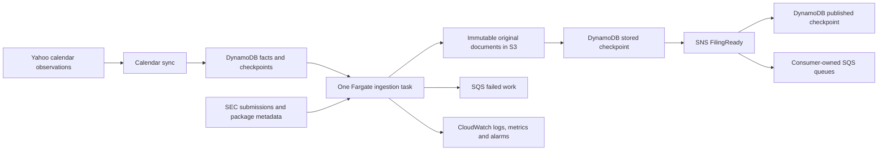

# SEC document acquisition architecture

This document describes the current service and its durable contracts. The POC
migration and subsequent earnings-filtering work are complete. Use
[README](../README.md) for installation, commands and settings,
[DECISIONS](DECISIONS.md) for rationale, [DEPLOYMENT](DEPLOYMENT.md) for operations,
and [BACKLOG](BACKLOG.md) for open work. Historical plans are recoverable in Git.

## Scope and ownership

The repository/distribution is `finbot-filings`; the installed Python namespace
is `finbot_ingestion`. It discovers SEC filings, selects relevant documents,
preserves original response-content bytes in S3, records durable facts in
DynamoDB and publishes metadata-only `FilingReady` events through SNS.

Current coverage is the [72-company curated universe](PRODUCTION_UNIVERSE.md),
expanded from the original 50 companies on October 15, 2026.
Approximately 500 companies is the capacity target, not the current company count.
CIK is stable company identity; ticker is lookup/convenience metadata. The runtime
requires an existing nonempty enabled universe and never provisions or seeds it.
The separate local operator tool `scripts/load_companies.py` reads the consolidated
company JSON, validates all records and the target account, and conditionally
inserts missing CIKs. Existing companies are skipped without configuration changes;
repeat or interrupted loads resume per record. This does not change runtime table
ownership, discovery or package contracts. See the company-universe runbook.

Document interpretation, financial extraction, features, consumer queues and
portfolio/trading decisions belong downstream. Historical backfill tooling,
Company Facts, global EDGAR feeds, RAG, multiple ingestion tasks and distributed
rate limiting are outside the current service. This cloud producer does not use
the workspace's local Parquet/catalog pipeline or `FINBOT_DATA_ROOT`.



## Filing admission and document selection

`selection/policy.py` and `selection/six_k.py` implement deterministic
`earnings-acquisition-v3` routing.
`LIVE_INGESTION_START_AT` defaults to **2026-10-06T04:00:00Z**, inclusive, using
SEC acceptance time (October 6 midnight in America/New_York). It is a fixed saved
configuration value shared by restarts, deployments and newly enabled companies.
Calendar dates affect polling cadence, not acquisition eligibility. Do not
reset/widen the cutoff to perform backfill.

| Filing/document | Current rule |
| --- | --- |
| `8-K`, `8-K/A` | Require unambiguous Item 2.02 evidence |
| `10-Q`, `10-K`, and their `/A` amendments | Retain the primary financial report |
| `6-K`, `6-K/A` | Require an explicitly identified reported-results release or periodic financial report |
| Selected earnings 8-K | Retain primary plus identified earnings releases and financial supplements in HTML/text/PDF |
| Decks, standalone graphics/logos, complete submission TXT bundles, unrelated exhibits, auxiliary files | Exclude |
| Missing/conflicting item evidence or ambiguous exhibit role | Record an unresolved diagnostic; never assume relevance or irrelevance |

The submissions parser returns all eight supported forms without a count cutoff;
admission happens separately. Identical accession duplicates collapse. Conflicts,
invalid relevant rows and invalid acceptance timestamps reject the response rather
than allowing a caller to checkpoint it as complete. Historical submissions-file
traversal is deferred; downtime recovery is limited to filings still present in
the recent response and already durable pending work.

Package discovery reconciles the HTML document table with directory JSON and
preserves descriptions/types. It resolves inline-viewer links, validates safe
accession paths and collapses compatible duplicate references. A missing primary
name resolves only when one document matches the filing form. Missing, empty or
inconsistent snapshots fail explicitly and are retried.

Descriptions and safe primary-report exhibit references determine release and
supplement roles; neither EX-99.1 nor EX-99.x alone proves eligibility. Attachment
routing uses SEC index descriptions, one-exhibit table rows and each
safe same-package hyperlink's own text. Layout rows linking multiple documents
do not share a row description across attachments. Descriptions normalize
whitespace and match case-insensitive whole-word phrases, without filename guesses.

| Attachment description | Additional evidence required | Role |
| --- | --- | --- |
| Existing earnings/financial/quarterly/annual/operating release/report/announcement language | None | Earnings release |
| Press release, news release, earnings release | Existing financial-results language, or exact EX-99.x number explicitly referenced within Item 2.02 | Earnings release |
| Financial/statistical/earnings supplement, financial data supplement; supplemental/supplementary financial/earnings/statistical language | None | Financial supplement |
| Quarterly supplement | Exact EX-99.x number explicitly referenced within Item 2.02 | Financial supplement |
| Supplementary/supplemental sales data, financial statements, statement(s) of earnings/income/operations | None | Financial supplement |

These attachment rules run only after filing admission and existing type/format
checks. Item 2.02 reference evidence ends at the next structural Item heading;
cross-references in prose do not start another section. The exact exhibit number
comes from the package document type. Generic PDF labels and exhibit numbers alone
remain unresolved. Presentation/deck/slide descriptions retain precedence: a
presentation alone is excluded; a presentation combined with a selected financial
role remains unresolved and is skipped. Decision reasons remain `earnings_release`
and `financial_supplement`, including selected financial statements.

Missing submissions items may be resolved from index metadata or structural primary
headings. Primary routing inspection is bounded to **4 MiB**; unsupported/larger
layouts remain unresolved. Clearly selected documents can proceed while ambiguous
attachments are skipped. Bounded text inspection may warn about image-only HTML;
there is no OCR, financial interpretation or fetching excluded attachments to
classify them. Legitimate selected `.txt` releases remain allowed; submission
bundles are excluded by accession-bundle identity. No linked images, stylesheets,
scripts or investor-relations content are acquired.

Fresh known exclusions create no work. Unresolved filing routing removes pending
enumeration eligibility through a selection checkpoint. Discovery and every
pending acquisition/publication path, including direct worker calls, use the same
policy. Published records and terminal/dead-letter obligations stay intact.
Completion covers selected documents, not preservation of the entire SEC package
or every earnings disclosure.
The reviewed v1-to-v2 transition permits only previously affirmative checkpoints
to upgrade during re-evaluation, preserving the first affirmative reason and all
processing facts. Blocked/terminal/published records are not reactivated or rewritten;
unknown policy changes and downgrades remain guarded. Completed enumeration
timestamps/counts remain immutable and completed packages are not automatically
re-enumerated. A separately scoped recovery operation is needed to acquire earlier
omissions. The operator-only DAL/WFC/JNJ recovery helper reuses package selection,
revalidates a read-only manifest against strong canonical reads and fresh SEC
evidence, and conditionally creates only four allowlisted missing children with
v2 SELECT checkpoints. It does not reopen/update the completed parent snapshots.
Pending ACQUIRE work resumes through the normal worker, storage and publication
path after restart; existing artifacts and calendar/satisfaction records are
untouched by the helper.

### Earnings-only 6-Ks

6-Ks have no Item 2.02 admission shortcut. A short description/primary section
must identify reported quarterly, half-year or annual financial results, or an
actual periodic financial report/statements, together with the reporting period.
Headlines reporting revenue/net sales/net income/EPS can establish results without
parsing the values. Future announcements, board approval notices, AGM results,
prospectus/pro-forma material and historical/boilerplate references are excluded
as affirmative evidence. A real results report can include guidance or governance
updates elsewhere. Evidence is evaluated within blocks, never by combining keywords
across the whole filing.

SEC index descriptions, safe links and short primary sections supply labels.
Quoted announcement/exhibit titles beginning after `regarding` may continue across
at most three adjacent absolute-positioned leaf divs in one container. Reconstruct
only through their closing quotation, within the 1,500-character bound; stop at
another exhibit, heading, non-layout node or container boundary. Preserve links
from every line for normal binding/conflict checks; do not concatenate paragraphs.
Plain numbered exhibit rows and attached-Item/Exhibit paragraphs bind to the
unique package EX-99.x file; multi-file/multi-number/conflicting bindings remain
unresolved. Resolve each document's combined labels before using it to qualify
the filing. At least one affirmative results document must survive that check,
unless an independent primary section already reports results. Linked exhibit
descriptions are attachment evidence, not independent primary results evidence.
Only then may results context select generic supporting supplements. If the sole
qualifying document has conflicting labels, the filing remains unresolved and
cannot satisfy the earnings calendar. Unsupported types/formats and missing
referenced files cannot admit an otherwise generic package. Blocks are capped at
1,500 normalized characters; primary routing downloads/parsing at 4 MiB.
Oversized inspection stays unresolved
unless explicit index evidence already qualifies the package. Normal selected
acquisition retains its 64-MiB limit. Primary routing bytes reuse immutable storage.

An otherwise UNRESOLVED package may inspect at most two generic press/news release
attachments, ordered by filename. Each must be a uniquely numbered EX-99.x HTML/text
document with a validated same-package URL and no classified/conflicting labels.
Each read uses the shared SEC client/budget and a 4-MiB cap (at most 8 MiB of
additional bodies per enumeration). Oversize remains unresolved; transport errors
use ordinary workflow retry. No PDF/OCR or image inspection is added.

After removing head/script/style/comments and empty/exhibit-marker blocks, require
an opening headline about results or reported financial measures, then affirmative
reported-results/period evidence in an individual one of the first four blocks.
Apply existing notice/reference/deck/approval guards. Do not combine periods and
results across blocks or inspect later boilerplate. Attach the qualifying block
only to that document's labels and resolve conflicts before admitting the package.
Only selected routing bodies pass through normal immutable storage; enumeration
reuses inspected original bytes instead of fetching the release again. No durable
evidence store, ticker/filename classification rules or new checkpoint schema.

A selected package retains its primary and individually identified results releases,
periodic financial reports/statements, and financial/operating supplements.
Presentations, transcripts, newspaper advertisements, graphics, bundles and unrelated
files are excluded; ambiguous children are omitted while clear documents proceed.
PDFs can qualify from labels without PDF interpretation. Unknown/image-only layouts
remain a coverage limit. Persist only existing SELECT/EXCLUDE/UNRESOLVED checkpoints
with minimal reasons, including parent `earnings_6_k`; no evidence records/excerpts.

V3 keeps domestic v2 selection unchanged and permits affirmative v1/v2 checkpoints
to upgrade during pending re-evaluation. Existing blocked work stays blocked,
completed snapshots stay immutable, and no reset/backfill is introduced.

## Identity, time and public event contract

| Concept | Contract |
| --- | --- |
| Company | Ten-digit zero-padded CIK; reviewed ticker/name/enabled configuration |
| Filing | Dashed SEC accession number; amendments have new identities |
| Artifact | `<dashed-accession>/<original-filename>` |
| S3 key | `<ticker>/<YYYY-MM-DD>_<form>_<accession>/<original-filename>` |
| `filed_at` | SEC `acceptanceDateTime`, normalized to aware UTC; not measured public availability |
| `discovered_at` | First canonical discovery observation |
| `stored_at` | Original S3 HEAD `LastModified`, including repair |
| `published_at` | First durable publication checkpoint |

Folder dates use SEC acceptance time in America/New_York (including DST), not
runtime/discovery time. Forms replace `/` with `-` in folder labels; accession
remains present to distinguish same-day filings. The original canonical artifact
ticker supplies the top-level folder. The parent filing is passed into storage
operations and its accession/CIK/form must match the artifact, without duplicating
acceptance time in artifact rows. Earlier layout images are incompatible active
rollback targets after the explicit reset; see ADR 013.

Original filename case is preserved. Filenames must be safe basenames without
separators, traversal names or control characters. SEC URLs use numeric CIK and
dash-free accession path components. Missing/invalid/naive acceptance timestamps
fail; filing/report dates never substitute. S3 URI paths are percent-encoded;
consumers decode the URI path to obtain the actual key. No application content
hash or ETag-based identity is used. Original discovery/ticker facts remain
canonical on rediscovery, including after ticker configuration changes.

`FilingReady` is `filing.ready` / schema `1.0`. The unit of notification is a
filing with its complete selected stored document list, including a primary ID,
company name, deterministic snapshot ID and stable readiness time. The exact
payload, hash encoding, persisted notification rows and recovery rules are in
[FILING_READY](FILING_READY.md). The topic is `<prefix>-<environment>-filing-ready`, supplied through
`FILING_READY_TOPIC_ARN`. There are no per-file notifications in the new runtime. Consumers deduplicate by `(filing_id, snapshot_id)` and own their queues.


## DynamoDB schema and access patterns

Four separately configured tables are required. All base/index keys are strings;
fixed indexes use **KEYS_ONLY** projection.

| Table | Base partition / sort key | Index | Index partition / sort key |
| --- | --- | --- | --- |
| Companies | `cik` / none | `EnabledCompanies` | `enabled_marker` / `cik` |
| Calendar | `expected_date` / `cik` | None | — |
| Filings | `accession_number` / none | `PendingFilingEnumeration` | `pending_work_kind` / `pending_work_sort` |
| Artifacts | `artifact_id` / none | `PendingArtifactWork` | `pending_work_kind` / `pending_work_sort` |
| Artifacts | same | `ArtifactsByAccession` | `accession_number` / `filename` |

`repository_schema_version=1` is present on application records. Processing rows
start at numeric revision zero; guarded updates increment revision atomically.
Optional facts are omitted, not NULL. Persistence timestamps use fixed-width
`YYYY-MM-DDTHH:MM:SS.ffffffZ`; event JSON uses UTC ISO timestamps ending in `Z`.
Serialization validates numeric/identity fields, UTF-8 key limits (2048/1024 bytes)
and a conservative 400-KB item bound. Raw calendar diagnostics are finite JSON
encoded in `raw_provider_payload_json`; SDK AttributeValues never escape adapters.

| Record | Durable content |
| --- | --- |
| Company | Ticker/name/enabled plus `enabled_marker=ENABLED` only while enabled; configuration is mutable |
| Calendar expectation | Ticker/timing/provider, optional source ID/update time, `synced_at`, optional diagnostic JSON/replacement hint, `calendar_active` tombstone flag |
| Filing | Canonical CIK/ticker/company name/form/acceptance/discovery/source/primary metadata; enumeration, selected membership and filing publication checkpoints |
| Artifact | Canonical parent/CIK/ticker/form/type/filename/source/discovery metadata; paired `s3_uri`/`stored_at`, optional content type/byte count, publication and processing checkpoints |

Base-key reads and calendar date queries are strong. GSI queries are eventual;
candidates are hydrated through strong reads and rechecked before action. Calendar
ranges query each inclusive UTC date partition within the configured maximum span
(default 366 days). Sync and satisfaction records occupy reserved partitions:

| Partition (`expected_date`) | Sort key (`cik`) | Content |
| --- | --- | --- |
| `__calendar_sync__` | Provider | Typed revision-guarded latest run, separate full/near-term successes, sanitized failure facts |
| `__event_satisfaction__` | Canonical event identity JSON | Validated immutable match facts used to stop aggressive polling |

Sync records identify provider/kind, request ID, exact company/date scope,
observation/completion time, event/cancellation counts and failures. Repeating a
request ID reuses its canonical run; observation times increase across restarts
and clock rollback. Completion/failure requires the latest run. Compatible lost
acknowledgments preserve first completion; late failure cannot replace success.
Near-term success never replaces full success or hides another kind's failure.

Queries use scoped opaque SDK continuation tokens bound to region/query/table/
index/page size. There are no scans, FilterExpressions, TTL or recovery-age bounds
in normal application access. Continue empty actionable pages when a token remains.
Repeat whole passes to account for delayed index entries and inserted earlier work;
one empty pass cannot prove global completion. Low-cardinality work partitions
are a deliberate single-task choice, not a throughput or cost guarantee.

### Conditional creation and durable updates

Filing/artifact creation requires `attribute_not_exists(primary_key)`. A conflict
triggers a strong read: compatible rediscovery returns existing canonical facts;
incompatible identity/CIK/form/source provenance fails. Optional primary/type values
conflict when both are populated differently. Ticker/discovery updates never
replace first observations. Artifact creation accepts unprocessed discoveries.

Updates require existence plus matching revision, with bounded CAS retries that
reread and recompute. Missing records fail without phantom upserts. Compatible
repeated checkpoints preserve the first time; incompatible storage facts fail.
`mark_published` requires paired storage facts and removes file pending eligibility
after an acknowledged filing notification. Filing readiness/publication has its own
durable pending checkpoint and saved event; see FILING_READY.
Late failures cannot resurrect completed work. Repeated logical failure writes
reuse timestamp/error; equal matching or older observations do not count again,
and equal-time conflicts fail. Error text is bounded to 2048 characters. Legacy
retry counts are chronological diagnostics, not an exact concurrent audit ledger.

`PackageCheckpoint.persist()` validates canonical parent, resolved primary and
unique children, conditionally creates each child and strongly confirms durability
before marking enumeration complete. Known child identities are dispatched
directly rather than waiting for accession-index visibility. The first completed
snapshot retains timestamp, primary and positive child count. Explicit later
validated snapshots may add children; automatic completed-package rechecks are
deferred. Selection does not rewrite old snapshot counts/times. No package-wide
transaction or unbounded embedded manifest is used.

### Pending, selection and failure checkpoints

`pending_work_sort` is original fixed-width discovery time plus `/` and identity;
retries never move it. Pending keys change in the same write as durable progress:

| Durable facts | Pending work |
| --- | --- |
| Incomplete parent enumeration | `ENUMERATE` |
| Completed selected filing awaiting readiness/SNS checkpoint | Filing `PUBLISH` |
| Unstored artifact | `ACQUIRE` |
| Stored, unpublished artifact | `PUBLISH` |
| Terminal failure, send not checkpointed | `DEAD_LETTER` |
| Published/completed or dead-letter checkpointed | None |
| Selection `EXCLUDE` / `UNRESOLVED`, without terminal obligations | None |

Processing checkpoints add `selection_policy`, `selection_decision`
(`SELECT`/`EXCLUDE`/`UNRESOLVED`), `selection_reason` and `selection_checked_at`
together. `record_selection()` uses revision/existence guards. A skip invents no
storage, publication or terminal success/failure. Contradictory evidence can block
previous SELECT work; blocked work cannot automatically re-enter pending indexes.
Published/terminal records, including pending dead letters, remain untouched.

Enumeration, file acquisition and filing publication have independent persisted workflow-failure
counters and paired latest stage/error/time facts. Immutable terminal facts contain
stage/error/type/time; optional `dead_lettered_at` records the first successful
operational send. Terminal stage must agree with unfinished work. Old rows may omit
additive fields; validators reject partial facts or inconsistent pending membership.
Older adapters cannot safely process newer terminal/calendar/selection records.

Terminal facts precede an `ingestion.work_failed` / `1.0` SQS envelope, containing
canonical work/source identifiers, stage, terminal time, error/type/count and
optional S3 reference, never bytes. Its stable `failure_id` is
`<filing|artifact>/<identity>/<stage>/<terminal-time>`. SQS MessageId precedes the
send checkpoint; lost acknowledgments can duplicate that failure ID. The ingestion
failed-work queue is separate from downstream queues/subscription DLQs.

Partially created children defer until parent enumeration completes; terminal
parents keep them deferred and supply the package failure envelope. Pagination
continues past deferred/failed work. Invalid metadata/storage conflicts terminalize
immediately; retryable source/SDK/CAS failures consume stage budgets. Shared
credential/permission/resource/configuration errors propagate rather than
terminalizing every company. Cancellation is never a workflow failure. Normal
workers never redrive terminal work; durable facts remain after queue retention.

## Storage, acquisition and repair

The ordered path is **all selected S3 objects → stored checkpoints → strong
reloads → saved filing event → SNS → filing published checkpoint**. When a record lacks storage facts, inspect S3 before downloading.
Compatible existing objects repair metadata without replacing bytes. Missing,
malformed or conflicting provenance fails explicitly; HEAD permission errors do
not mean absence.

S3 creation uses direct `PutObject(IfNoneMatch="*")`. Versioned ASCII JSON object
metadata `finbot-provenance` version 2 records identity, CIK, original
ticker/form/type, SEC URL, acceptance timestamp and original discovery time; `finbot-content-type` records original type.
The provenance envelope is bounded to 1800 bytes, total user metadata to 2048
bytes and S3 keys to 1024 UTF-8 bytes. HEAD LastModified/ContentLength/type establish
stored facts for both initial writes and repair. A 412 reconciles existing content;
409/ambiguous writes inspect before bounded conditional retry. Only specific
missing-object 404 means absence; missing bucket/403 errors propagate. GetObject
and scoped ListBucket permissions support reliable absence detection. Ingestion
has no deletion or unconditional-overwrite permission.

Downloads stream original decoded response-content bytes, with no text transcoding
or interpretation. Selected acquisition has a maximum **64 MiB** per artifact,
configurable downward. Excess Content-Length or counted bytes fail explicitly;
there is no multipart fallback. Two whole artifact workflows run by default;
buffer conversion can temporarily retain two copies per workflow. Shared admission
slots bound primary routing bodies as well. Up to 32 package decision maps are
cached without bodies; eviction/restart rechecks metadata. Primary bytes fetched
for routing reuse the same immutable storage path rather than downloading twice.
Stored artifacts never download again for filing publication retries.

## SEC transport and runtime

Synchronous `SecClient` uses reused requests sessions behind one shared
`SECRateLimiter` and a bounded executor. Blocking HTTP/SDK calls never run on the
scheduler event loop. One SEC attempt is in flight; dispatch is serialized from
admission through response receipt, including streaming. Every poll, index,
download, retry and redirect consumes the same **five-request/second maximum**,
with pacing and a rolling-one-second guard. Lower configured ceilings apply.
Slow responses reduce throughput; maximum admission rate is not promised capacity.

HTTP retries/redirects are explicit and bounded; automatic transport retries and
redirects are disabled. Connection/timeouts, 403/429/5xx and package-index 404
receive centralized jitter/backoff and bounded Retry-After. Redirects stay on
official HTTPS SEC hosts. Successful source responses are never indefinitely
cached. All calls use an identifying SEC User-Agent. Public SEC methods are
`get_company_submissions`, its evidence-aware variant, `get_filing_index` and
`download_document`; async ingestion/repository interfaces are defined in source.

One RuntimeApplication shares repositories, identity locks, worker/recovery and
calendar sync. Default eleven supervised loops comprise scheduler, recovery,
refresh, reload, heartbeat, metrics, two poll workers, one enumeration worker and
two artifact workers. Pools/queues are bounded. Poll admission is nonblocking;
filing/artifact handoff has backpressure. Queued/in-flight identities suppress
duplicates. Recovery runs at startup and repeatedly after completion, independent
of company enabled status. Disabling a company stops polls, not durable recovery.
Coarse reloads hydrate universe/calendar/satisfaction; scheduler ticks do no
DynamoDB I/O. Due times use monotonic completion-based intervals with CIK-staggered
safety polls and no catch-up bursts. UTC wall time determines event windows.

Market windows use actual offline XNYS sessions, New York dates, DST, holidays and
early closes. Unknown timing gets a wider window; non-session expectations keep
their date with a configured fallback. Coverage errors are distinct from holidays.
Window caches are bounded and reload spans include past/grace/pre-window coverage.
Defaults and environment names are in [README](../README.md#calendar-scheduling-and-observability).

Required-loop failure, unexpected return or stalled busy work exits nonzero; idle
workers remain healthy. SIGTERM/SIGINT stops producers and new SEC/Yahoo admissions,
including paced attempts, retries and redirects. Queues drain within the configured
grace, then cancel cooperatively. Repeated cancellation cannot release admission
before actual blocking I/O finishes or close a client still in use. Drain grace is
not a hard total I/O deadline; forced termination relies on durable recovery.

### Earnings satisfaction is a separate scheduling policy

New domestic checkpoints use `earnings-satisfaction-v2`: matching CIK and SEC acceptance
on the provider's expected calendar date in `America/New_York`, plus one exact
original form. Its `[window_start, window_end)` runs from local midnight to the
following local midnight; `grace_end == window_end`. Construct each midnight in
the local zone so DST days may span 23 or 25 hours in UTC. Weekends and holidays
retain the expected date. Before/after-market hints, sessions and runtime polling
configuration do not narrow or extend this matching interval.

| Form | Required evidence | Saved reason |
| --- | --- | --- |
| `10-Q` | None | `original_10_q` |
| `10-K` | None | `original_10_k` |
| `8-K` | Unambiguous submissions Item 2.02 | `original_8_k_item_2_02` |
| `6-K` | Completed v3 SELECT / earnings_6_k filing checkpoint | `original_6_k_earnings` (matching v3) |

Amendments/generic or ambiguous 8-Ks cannot satisfy expectations. Admission may
use index/primary routing evidence; satisfaction never fabricates submissions
evidence from filenames, descriptions or contents. Candidates sort by acceptance
then accession; ambiguous same-company expectations on the same date remain
unsatisfied, including overlaps with already-satisfied events. Accessions loaded
from existing satisfaction checkpoints cannot be reused for a different event,
even if a provider ID's expected date has moved.

Persist satisfaction only after validating the durable filing and match facts:
accession/CIK/acceptance, expected date, window/grace bounds, reason/policy version,
original form and required normalized SEC items/evidence source. Event identity is
compact canonical JSON `[provider, CIK, "id", provider_event_id]`, or
`[provider, CIK, "date", expected_date]`, bounded to the 1024-byte sort-key limit.
Conditional creation and strong conflict/acknowledgment reads retain the first
compatible checkpoint; unknown policy versions fail explicitly. Readers accept
v1, v2 and v3. V1 retains its original polling-window/grace validation and bounds;
v2/v3 additionally require exact New York day bounds for the observed expected date.
Existing v1 matches are hydrated as satisfied and never upgraded or rewritten.
Satisfaction is separate from mutable calendar rows and survives refresh/restart.
Durable satisfaction starts a fixed ten-minute follow-up period at the active poll
cadence; safety polls/recovery continue afterward.
It neither waits for publication nor proves extracted/validated earnings.

For original 6-Ks, matching uses `earnings-satisfaction-v3` and the same exact
New York date bounds. Normal polls strongly read the canonical filing checkpoint;
only completed v3 affirmative earnings routing qualifies. The satisfaction
repository independently rechecks that checkpoint before conditional creation.
No SEC item codes or evidence source are invented. Missing classification cannot
suppress polling; a subsequent poll can link the completed filing without fetching
its package or documents again. Existing domestic v1/v2 matches remain unchanged.
The dashboard validates the same form/reason/version and canonical selection facts.

Polling still uses `WindowPolicy` session windows and configured grace. Only
matching uses the calendar-day policy. Normal discovery returns canonical SEC
observations even for completed parents, allowing missing matches to be established
on subsequent polls without package enumeration, downloads or republication.
This is limited to loaded calendar expectations and normal recent submissions;
it does not introduce historical backfill or change acquisition selection.

The scheduler uses each checkpoint's original `satisfied_at` to continue frequent
polling until `satisfied_at + 10 minutes`, independent of the original polling
window's boundaries. This applies to v1/v2/v3 checkpoints. Reload and restart
hydrate the same timestamps; expired checkpoints do not start a new follow-up.
Compatible conditional-write replay also reads the retained timestamp instead of
using the latest attempted write time. Later filings do not replace the match or
extend its deadline. Another unsatisfied expectation can still independently keep
the company active. Completion-based cadence, retry backoff, queue coalescing and
the shared SEC request budget remain in effect. Scheduler ticks make no durable
reads, and no new database fields are introduced.

## Yahoo calendar synchronization

Provider selection is explicit: `yahoo` or default `placeholder`. Placeholder
raises `CalendarProviderNotConfigured`; it never invents an empty snapshot or
establishes freshness. Authoritative fixture providers retain omission-based
reconciliation; Yahoo uses replacement-only observations.

A CalendarSnapshot identifies provider, inclusive dates, exact sorted CIK scope,
normalized expectations and completeness. Freeze and paginate enabled companies;
empty/ambiguous universes fail. Validate full scope, limits, duplicates, timing and
finite diagnostics before expectation writes. Canonical ticker and monotonic
run observation time supply metadata. Failed/incomplete collection preserves
expectations and last successful freshness. Partial database application is not
atomic: success follows every required write, and a fresh validated snapshot
repairs interruption. No stored snapshot is replayed during provider outages.

Pinned `yfinance==1.7.0` / `curl_cffi==0.16.3` use an owned private `YfData.post`
seam; public DataFrames discard completeness evidence. Upgrade review must check
this boundary. Raw day slices validate query/schema/offset/total/count, terminal
empty pages and repeated slice consistency under aggregate HTTP/row/page/deadline
bounds. Page sizes, offsets and totals use distinct ticker groups, while every
expanded event row is retained, validated and charged to the raw-row budget.
Require exactly the expected number of ticker groups per page and total; advance
offsets by groups received and reject a ticker repeated on another page, even with
a different event. A terminal page must be empty. Compare the complete event maps
across verification passes, not just ticker membership. Curated-company event
ambiguity remains a failure. See ADR 022. Each slice is enumerated twice; instability permits at most one bounded
restart. Request/auth/redirect/retry budgets are independent of SEC. New York
midnight bounds handle DST/adjacent overlap; D through D+29 uses upper query date
D+30. Curated ticker mapping must be unambiguous; BMO/AMC normalize to coarse
before/after-market, other codes to unknown. Financial extras are ignored.
Collection consistency does not establish independent company coverage or a
provider-wide atomic snapshot.

Only unique same-provider/CIK recognized quarterly-title hints
(`quarterly-announcement-v1/YYYY/Qn`) can link a date replacement. This optional
hint is not a provider ID or independently verified fiscal identity. Yahoo event
IDs/source update timestamps remain null. Missing hints, both dates present,
multiple candidates and out-of-confirmed-scope replacements preserve old events.
Known different quarterly hints at the same CIK/date reject a snapshot. Existing
incoming keys are excluded from old candidates so interrupted upserts can repair.
Strongly confirm the exact replacement before guarded cancellation of the unchanged
old observation. Disabled/other-provider/outside-range rows remain protected.

Calendar upserts accept absent or strictly newer observations; equal-time identical
repeats succeed, equal-time conflicts fail, older observations are ignored.
Cancellation retains fields, advances sync time and sets `calendar_active=False`.
Tombstones guard stale resurrection; old rows default active. Strong paginated date
reads omit tombstones. There is no physical deletion, TTL or tombstone compaction.
Date moves with Yahoo's null IDs require new satisfaction; old satisfaction is not
transferred to another date. Provider migration at occupied keys is deferred.

Refresh is completion-based, normally 30 inclusive days once daily with near-term
refresh disabled. Full and near-term success scopes remain separate. Restart may
reuse an unexpired daily success if company scope and scheduling coverage remain
sufficient, including across midnight; it must expose actual coverage rather than
claiming the new rolling tail was collected. Scope changes/insufficient coverage
trigger refresh. Full-success age and coverage determine freshness; near-term
success cannot hide stale full state.

Yahoo session, cookie/timezone SQLite caches and blocking work have one dedicated
owner thread/executor. Caches are private temporary state at `/tmp/finbot-yahoo`,
mode 0700, writable by the non-root runtime, never durable provenance or credentials
to log/commit. Stop closes admissions, awaits bounded I/O and closes resources on
their owner thread. Help/heartbeat checks neither initialize Yahoo nor contact it.
The provider-only diagnostic is documented in [DEPLOYMENT](DEPLOYMENT.md#one-shot-live-calendar-check).

## Observability, deployment and capacity limits

Sanitized JSON logs go to stderr; bounded thread-safe EMF goes to stdout with
Service/Environment dimensions. `SecRequests` additionally publishes independent
Ticker and CallType dimension sets and their combination. One atomic dispatch
counter update and shared flush timestamp preserve the total across all views;
retries and redirects retain their company/type attribution. Other metrics keep
their existing dimension sets. See [request charts](../README.md#sec-request-breakdowns-in-cloudwatch).
CIK/accession/artifact IDs stay in logs. Metric
buffers cap samples/names and report drops. Operational samples can repeat during
repair and are not an exactly-once ledger. Discovery latency measures SEC acceptance
to first discovery; download latency is artifact discovery to storage; ingestion
latency is acceptance to storage. None measures public availability or consumer
completion. Discovery latency remains observable as a metric; its CloudWatch
alarm is disabled by default via `discovery_latency_alarm_enabled=false` until
production latency commitments justify explicit activation. Other alarms remain
independent. See ADR 021. Atomic local heartbeat health is separate from calendar scope/age and
provider readiness; no inbound health API is exposed.

CDK owns retained state and a stopped-by-default ARM64 runtime. GitHub owns tested
application revisions through scoped OIDC; infrastructure remains manual. Keep
one active process, immutable digest releases and the explicit STOPPED handoff.
Production deployment settings are tracked in `infra/cdk/config.prod.json`;
account and contact inputs are supplied separately through the ignored local
file. The loader permits only those private fields, preventing hidden overrides
of the cutoff or image. See ADR 015 and the runbook for file selection.
The filing-topic cutover retains the legacy topic/export until a separate
retirement migration. Its runtime output preserves the old strong import while
publication/configuration use only the new topic; see ADR 020 and the runbook.
Automatic recovery uses min/max 0/100, 120-second stop timeout, 150-second SEC quiet
period and 300-second ECS health startup allowance. These reduce overlap risk
without formal cross-process exclusion and can delay earnings discovery materially.
[DEPLOYMENT](DEPLOYMENT.md) defines procedures; [DECISIONS](DECISIONS.md#adr-008)
records the tradeoff. Storage encryption follows [ADR 010](DECISIONS.md#adr-010).

Twenty-five companies polling every five seconds consume the entire SEC ceiling
before downloads, retries or safety work. Synthetic 500-company replay exercises
bounded queues, shared budgets and delayed disabled-company recovery; it is not a
production tail-latency, memory, billing or provider-reliability guarantee. FIFO
dispatch remains because replay did not justify extra fairness/cache machinery.
Historical numeric results from the original replay driver have been retired;
current source tests synchronize worker wait boundaries and include a slower-SDK
case. Reproduce offline with:

```bash
.venv/bin/python -m pytest -q -s tests/integration/test_runtime_capacity.py
```

## Maintaining these contracts

Keep SDK/provider payloads behind adapters, identities/checkpoints deterministic,
history immutable and tests offline. Source protocols/domain validators are the
exact callable interfaces. Contract or architecture changes must update this
document and relevant decision; commands/settings belong in README.
Use failure/restart tests for durable changes. Do not introduce new services,
multi-task coordination or downstream interpretation without an explicit scope
change. Tests, CI and release artifacts hold execution evidence; maintained docs
describe current behavior and material unresolved limits.
